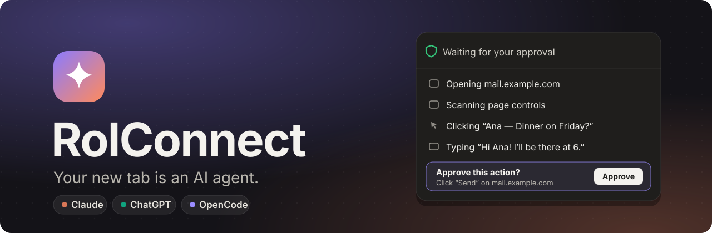
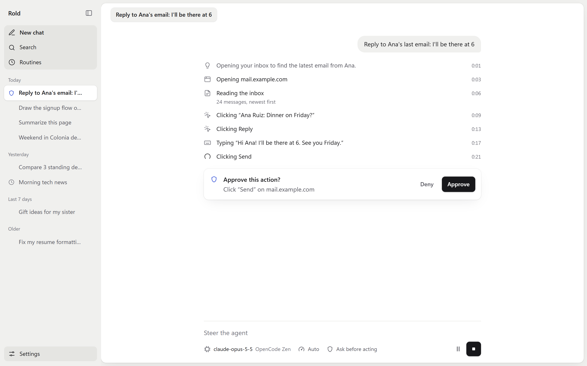
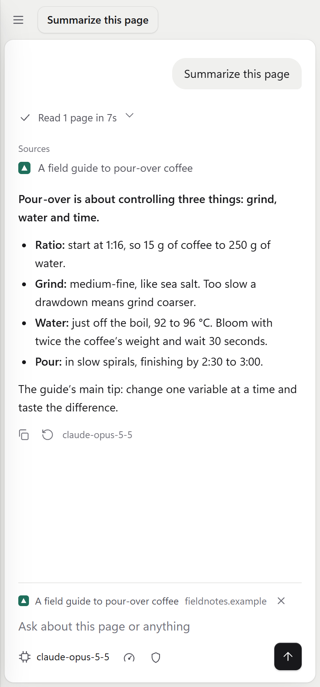
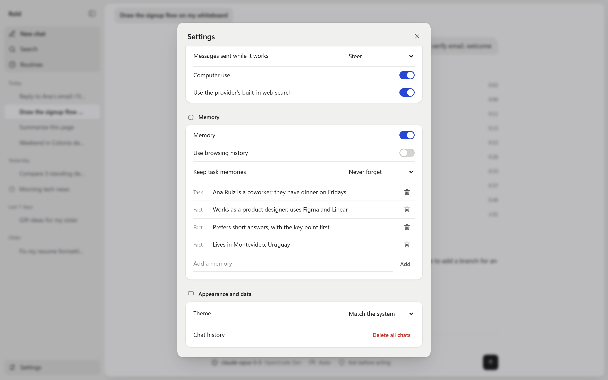

<div align="center">



<br>

[](#installation)
[](manifest.json)
[](LICENSE)

An AI chat on every new tab that is also a browsing agent. It searches the web, reads pages, and opens, clicks and types in your tabs, with **Claude**, **ChatGPT** or **OpenCode**.

</div>

<p align="center">
  
</p>

## Features

### 🧭 An agent that uses your browser
Ask for something and it does the steps: searches, reads pages, opens tabs, clicks buttons, fills in forms and presses keys. You see every step as it happens. The tabs it opens go into their own purple **RolConnect** tab group, so they never get mixed up with yours.

### 🖱️ Sees and uses any page
With **Computer use** on (Settings → Agent), it takes screenshots of tabs and uses a real mouse and keyboard, so it works with anything on screen: canvas apps, maps, editors, drag and drop. It works in background tabs without switching away from what you're doing. While it does, Edge shows a *"started debugging this browser"* bar, which goes away when the task ends; clicking **Cancel** on it stops screen control. With models that can't see images, it falls back to reading the page.

### 🛡️ You decide how much it can do
The pill under the chat box sets the permission mode:

| Mode | What the agent can do |
| :-- | :-- |
| **Read only** | Search and read pages and tabs. No clicking or typing. |
| **Guard** *(default)* | Everything, but it stops and asks before anything important: sending, buying, deleting, publishing, booking. |
| **Full access** | Everything, without asking. |

Password and card fields are always off-limits.

### 💬 Talk to it while it works
- **Steer:** type while it's working and the message reaches it right away, so you can correct it mid-task.
- **Queue:** or have your messages wait and run as soon as it finishes.
- **⏸ Pause** to take over the browser yourself, then **Resume**.
- Tasks keep running when you switch tabs or open another chat. If one needs your approval, the chat gets a badge and you get a notification.

### 🧠 Memory
It remembers what matters about you (where you live, how you like answers, who's who) and uses it in every chat. You can see, edit and delete every memory, and choose how long task memories last. It can also look through your browsing history if you turn that on.

### ⏰ Routines
Tasks that run on their own: every few minutes, daily, on weekdays or weekly. They run in the background and send a notification with the result. A routine can start a new chat each time or keep adding to an existing one, and you can ask the agent to set one up for you.

### 🪟 Side panel
The same chat next to whatever page you're on (**Ctrl+Shift+Y**). It knows which page you're looking at, so *"summarize this"* just works. You can also right-click any page or selection → **Ask RolConnect**.

<table>
  <tr>
    <td width="32%" valign="top"></td>
    <td width="68%" valign="top"></td>
  </tr>
</table>

<a id="installation"></a>

## Installation

1. Download this repo (**Code → Download ZIP**) and extract it, or `git clone` it.
2. Open `edge://extensions` and turn on **Developer mode**.
3. Click **Load unpacked** and pick the `RolConnect` folder (the one with `manifest.json`).
4. Open a new tab. When Edge asks about the changed new tab page, choose **Keep changes**.
5. Settings opens by itself: paste an API key, pick a model, and you're ready.

To update, pull or download the new version and click **↻** on RolConnect in `edge://extensions`.

## Accounts

| Provider | What you need | Web search |
| :-- | :-- | :-- |
| **Claude** | API key from [platform.claude.com](https://platform.claude.com) | Claude's own |
| **ChatGPT** | API key from [platform.openai.com](https://platform.openai.com/api-keys) | OpenAI's own |
| **OpenCode Zen** | Key from [opencode.ai/zen](https://opencode.ai/zen). One key covers Claude, GPT, Kimi, GLM, Qwen, DeepSeek… | DuckDuckGo → Bing |
| **OpenCode Go** | Key from your OpenCode Go subscription | DuckDuckGo → Bing |

Models load as soon as you paste a key. Under the chat box you can switch provider and model, and set the thinking effort for models that have it.

> [!NOTE]
> Claude and ChatGPT use API keys billed to your API account, since extensions can't use Claude.ai or ChatGPT subscriptions. OpenCode Go draws on your Go plan.

<details>
<summary><b>Everything the agent can do</b></summary>
<br>

| Tool | What it does |
| :-- | :-- |
| `web_search` | Search the web |
| `read_url` | Read any page (falls back to a background tab for sites that need JavaScript) |
| `list_tabs`, `read_tab` | See your open tabs and read them, including pages you're logged into |
| `open_tab`, `navigate_tab`, `scroll_page`, `close_tab` | Drive tabs |
| `get_page_elements`, `click_element`, `type_text`, `press_key`, `wait` | Use pages: buttons, links, forms, menus |
| `screenshot` | See a tab, including background tabs |
| `click_at`, `type_keys`, `scroll_at`, `drag` | Real mouse and keyboard at screen coordinates (Computer use) |
| `request_approval` | Ask you before doing something important |
| `search_history` | Search your browsing history (only when turned on) |
| `save_memory`, `forget_memory` | Remember or forget things about you |
| `create_routine` | Set up a scheduled task (always asks first) |

</details>

## Privacy

- Your API keys, chats and memories stay in this browser profile. They're never synced or sent anywhere else.
- Your messages, and the pages the agent reads, go only to the provider you picked. With OpenCode, web searches go to DuckDuckGo or Bing.
- No analytics, no tracking, no servers of its own.

<details>
<summary><b>Project structure</b></summary>
<br>

```
manifest.json         MV3 manifest: new tab override, side panel, context menus
background.js         side panel, right-click menu, routine alarms
newtab.html           new tab page
sidepanel.html        side panel
routine.html          background runner for routines
css/app.css
js/app.js             UI: chats, composer, settings, approvals
js/agent.js           providers (Anthropic Messages, OpenAI Responses, Chat Completions) + agent loop
js/tools.js           search, read, browser-control and computer-use tools
js/runner.js          runs a routine and saves its chat
js/routines.js        schedule math
js/storage.js         settings, chats, memories, routines
js/markdown.js        safe markdown renderer
```

No build step: edit a file and reload the extension.

</details>

## Bugs & feedback

Open an [issue](../../issues/new) with what you asked, what happened, and which provider and model you were using.

---

<sub>MIT License · Not affiliated with Anthropic, OpenAI, OpenCode or Microsoft.</sub>
